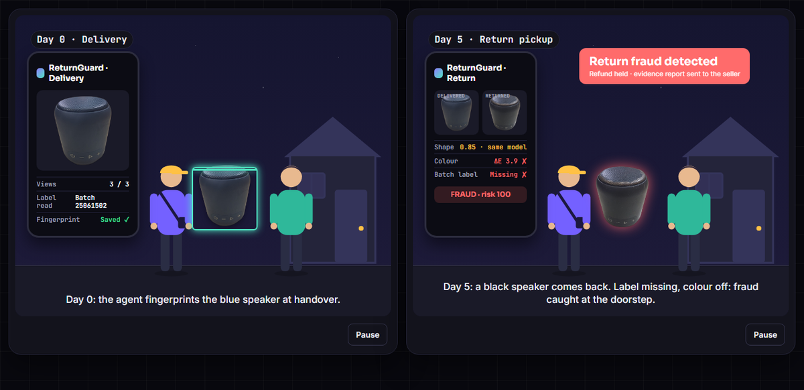
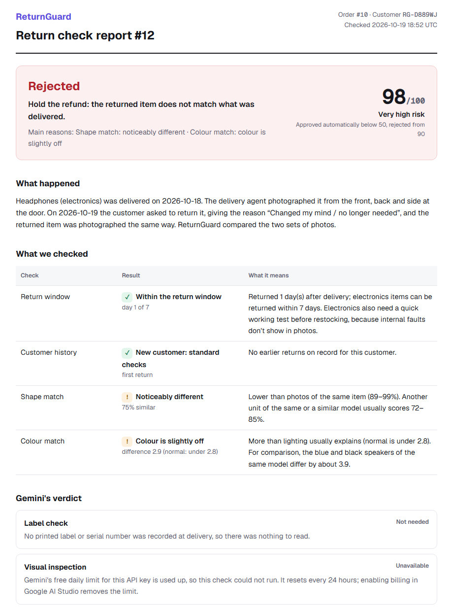
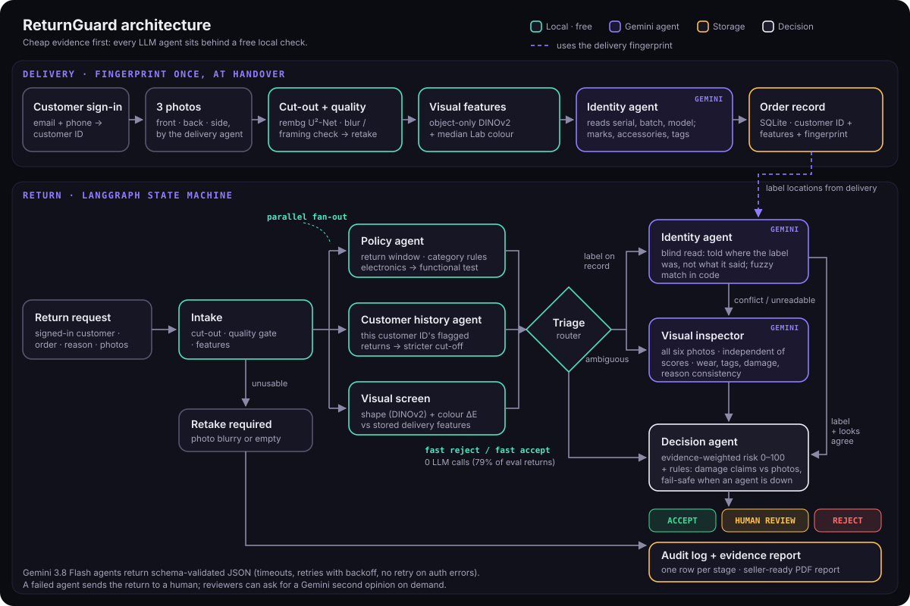

# ReturnGuard

**Catch return fraud at the doorstep, not the warehouse.**

[](https://rajthebuilder-returnguard.hf.space)
[](https://github.com/rajveer1421/ReturnGuard/actions/workflows/tests.yml)


[](https://www.kaggle.com/datasets/rajveergup1455/returnguard-product-photos)

**▶ Try it live: [rajthebuilder-returnguard.hf.space](https://rajthebuilder-returnguard.hf.space)**. Sign in with any
email and 10-digit number, then **Deliver → "Use the blue speaker"** and **Return → "Black speaker swapped in"**. It
takes about a minute. (On the free tier the Space sleeps when idle, so the first visit can take a minute to wake it.)

**Dataset: [ReturnGuard product photos on Kaggle](https://www.kaggle.com/datasets/rajveergup1455/returnguard-product-photos)**
(private, access on request): raw photos of 8 items, the 84 labelled same/different pairs, and the 2,496-pair photo
stress test with every distorted image, its score and contact sheets.

Retailers lost an estimated **$103 billion** to fraudulent returns in 2024, and about **15% of all returns** were
fraudulent ([Appriss Retail & Deloitte](https://apprissretail.com/news/appriss-retail-annual-research-fraudulent-returns-and-claims-cost-retailers-103b-in-2024/)).
A common trick is to keep the new product and send back an old or different one. Today that is usually caught in a
warehouse days later, after the refund has gone out.

ReturnGuard is a **multi-agent AI system** that checks whether a returned product is the *same physical unit* that was
delivered. The delivery agent photographs the product at handover. When it comes back, a **LangGraph** pipeline
compares the two with a free local vision screen (DINOv2 + colour), calls **Gemini agents only when the cheap evidence
can't settle the case**, and gives an explainable verdict (accept, human review or reject) before the refund is paid.



## Highlights

- **97.4% precision under stress** (2,016 of 2,070 flags were fraud, 95% interval 96.6–98.0%) with **100% recall**,
  across 36 photo-distortion conditions. F0.5 = **0.986** on the labelled set.
- **79% of returns decided with zero LLM calls.** 0.21 Gemini calls per return, about **$1 per 1,000 returns**.
- **Agentic design:** parallel policy, customer-history and vision agents; conditional routing; a **blind label-reading
  agent** that is told where the label was, never what it said; structured outputs; fail-safe when an agent is down.
- **Explainable:** every number is translated into plain language ("colour difference 3.9, normal is under 2.8"), and
  every verdict comes with a printable evidence report for the seller.
- **Honest evaluation:** confidence intervals on every rate, ablations against v1, held-out items, a photo-distortion
  stress test, and an evaluator that refuses to publish a run in which any LLM call failed.
- **Deployed:** live on Hugging Face Spaces, auto-deployed from GitHub Actions, with 35 offline tests in CI.

**Tech stack:** Python · LangGraph · Google Gemini (structured outputs via LangChain) · PyTorch · DINOv2 (Hugging Face
Transformers) · U²-Net background removal (rembg) · Pydantic · Flask · SQLite · Gradio server on Hugging Face Spaces ·
GitHub Actions

## Results

Measured by `python scripts/evaluate.py` on 48 labelled delivery/return pairs built from 6 physical items
(18 genuine, 30 fraud), with `gemini-2.5-flash`. Positive class = fraud; a return is *flagged* when it is not auto-accepted.

| System | LLM calls / return | Precision | Recall | F0.5 |
|---|---|---|---|---|
| v1: original embedding gate (patch-mean incl. padding, flag if ≤ 0.94) | – | 90.9% | 100% | 0.926 |
| v2: local evidence only (object-only DINOv2 + colour) | 0 | 100% | 100% | 1.000 |
| **v2: full multi-agent pipeline** | **0.21** | **100%** | **93.3%** | **0.986** |

**Stress test (precision under bad photos).** Every return photo was distorted 18 ways at two strengths (rotation,
viewpoint, distance, crop, lighting, colour cast, blur, noise, JPEG, low resolution, a finger over the lens, a new
background) and run through the local stage: **97.4% precision** (2,016/2,070, 95% interval 96.6–98.0%), recall 100%.
The weak spots are strong warm or cool light, very heavy JPEG compression and far-away photos.
Report: [results/stress_precision.md](results/stress_precision.md) (`python scripts/stress_test_precision.py`).

- **Cost and speed:** mean latency about 3 s per return on CPU (up to ~18 s when both Gemini agents run); structured
  output valid on the first try for 100% of calls.
- **Two misses, both on the steel bottles.** The local screen flagged them, but the Gemini inspector called the strap an
  "added accessory" and said "same unit, 95%". The fixes (treat a missing accessory as an incomplete return; escalate
  strong screen/inspector disagreement) are documented, not applied: they came from this same data and need new items
  to validate honestly.

### Limits, stated plainly

- **Small labelled set.** 28/28 flags were fraud, but with 48 pairs the 95% interval for precision is 88–100%, and the
  share of genuine customers wrongly flagged (0/18) could be as high as 18%. That is why the stress test above exists.
- **Simulated re-captures.** Most genuine return photos are edited copies of one photo session per item, and the
  thresholds were chosen on this data. Full report: [results/eval_report.md](results/eval_report.md).
- **Held-out test in progress.** Two Sony headphones were added *after* every threshold was frozen, photographed in real
  cluttered scenes with **4 real re-photographs**. They are much harder: genuine and swapped headphones overlap on shape
  (0.83 vs 0.75–0.82), so they rely on the Gemini agents. That run on `gemini-3.8-flash` is waiting on API quota and
  will be reported separately.



## Architecture



**Customer account.** Signing in with email and mobile number creates a customer ID (`RG-XXXXXX`). Every delivery
and return is tied to it, which is what the customer-history agent reads.

**Delivery (once, at handover).** Three photos → background removal and a capture-quality gate → object-only DINOv2
embeddings and median colour per view → **identity agent** (Gemini) records printed identifiers (serial, batch and model
numbers), distinctive marks, accessories and tags → the order row is created and its ID assigned.

**Return (LangGraph state machine).**

| Node | What it does | Cost |
|---|---|---|
| Intake | Background removal, quality gate (sends unusable photos back for a retake), features | local |
| Policy agent | Return window per category, reason eligibility, functional-test rule for electronics | local |
| Customer history agent | This customer ID's earlier flagged returns lower the auto-accept cut-off (repeat offenders get more review) | local |
| Visual screen | Shape (object-only DINOv2) and colour (ΔE) against the stored delivery features | local |
| Triage router | Fast reject / fast accept with no LLM, or call an agent | local |
| Identity agent | **Blind** label read: told *where* the label was, never *what* it said; fuzzy-matched in code | 1 Gemini call |
| Visual inspector | All six photos, independent of the scores: unit identity, wear, tags, damage, reason consistency | 1 Gemini call |
| Decision agent | Evidence-weighted log-odds risk score 0–100, routing rules, fail-safe | local |

Policy, history and the visual screen run **in parallel** (LangGraph fan-out). Every stage is timed and written to an
audit log, and every verdict comes with a printable [evidence report](#features) for the seller.

## What it catches

| Fraud pattern | How |
|---|---|
| Product substitution | Visual screen → fast reject |
| Same-model unit swap (old or broken unit returned) | Identity agent: label/serial missing or different; colour shift |
| False "arrived damaged" claim | Inspector compares against the handover photos |
| Damage after delivery | Inspector: new damage not present at delivery |
| Out-of-policy returns | Policy agent, no LLM |
| Repeat offenders | Customer history agent tightens the cut-off |

## Features

- **Customer accounts**: sign up or sign in with email and mobile number to get a customer ID; deliveries and returns require it, a customer can only return their own orders, and the account page shows exactly what the history agent sees.
- **Order created at delivery**: the database assigns the order ID, so deliveries can never overwrite each other.
- **Plain-language results**: every number is explained: "colour difference 2.1 (normal: under 2.8), same colour", "shape 85% similar, just below the usual 89–99% for the same item". Each check shows a verdict and what it means; the raw weights stay in a collapsible technical panel.
- **Gemini's verdict always visible**: what each Gemini agent concluded, or why it wasn't needed, or (in plain words) why it couldn't run. Reviewers can ask Gemini for an on-demand **second opinion**, which is recorded but never changes the original decision.
- **Live pipeline view**: the UI streams which agent is running, with per-view delivered-vs-returned comparisons.
- **Seller evidence report**: `/report/<return_id>` is a printable, human-readable page (save as PDF): what happened, what was checked and what each result means, Gemini's verdict, photos, next steps, and a technical appendix.
- **Resilience**: every Gemini call has a timeout, retries with backoff, rate-limit handling, and schema validation. If an agent still fails, the return goes to a human rather than being auto-accepted. A daily-quota error fails fast instead of sleeping for hours, and a server restart never leaves a return stuck in "processing".
- **Safety**: numeric-only order IDs, whitelisted media paths, upload size limits, and an optional per-IP rate limit for public demos.
- **35 offline tests** (no API key needed), run by GitHub Actions on every push.

## Quick start

```bash
# Python 3.11+ (conda or venv)
pip install -r requirements.txt
cp .env.example .env            # add your GOOGLE_API_KEY (Gemini)
python app.py                   # http://127.0.0.1:5000
```

The first request downloads DINOv2-base (~350 MB) and U²-Net (~170 MB). In the app, **Sign in** (any email and
10-digit number creates an account), then **Deliver → "Use the blue speaker"**, then **Return → "Black speaker swapped
in"** runs the full demo with bundled sample photos. The default model is `gemini-3.8-flash` (set `RG_LLM_MODEL` to change it).

```bash
python scripts/build_dataset.py   # Dataset/items → Dataset/{same,different}/... + pairs.csv
python scripts/evaluate.py        # writes results/eval_results.json (the website reads it)
python scripts/stress_test_precision.py   # photo-distortion precision test
pytest -q                         # 35 tests, offline
```

On a free-tier Gemini key, set `RG_LLM_MIN_INTERVAL_S=7` for evaluation runs to stay under the per-minute limit.
LLM answers are cached under `.cache/` during evaluation, so re-runs are free and reproducible.

## Project structure

```
app.py                     Flask API + UI routes, sign-in sessions, background return processing
returnguard/
  config.py                every threshold in one place
  imaging.py               loading, background removal (cached), capture-quality gate
  embeddings.py            object-only DINOv2 pooling + Lab colour signature
  llm.py                   Gemini wrapper: timeouts, retries, rate limits, schema validation, telemetry, eval cache
  schemas.py               Pydantic schemas for every agent's output
  pipeline.py              LangGraph return graph (parallel fan-out, conditional routing, streamed progress)
  explain.py               plain-language explanation of every check, for the UI and the report
  service.py               accounts, delivery registration, async return processing, second opinion, audit trail
  storage.py               SQLite: customers, orders, returns, audit_log
  agents/                  identity, inspector, screen, policy, history, decision
scripts/                   build_dataset.py, evaluate.py, stress_test_precision.py
deploy/huggingface/        Space entry point (Gradio server -> Flask), upload builder
Dataset/items/             raw photos: 8 items × front/back/side, two with a second photo set (see Dataset/README.md;
                           full dataset with labelled pairs and stress-test images on Kaggle)
results/                   evaluation output (JSON, Markdown, per-pair CSV)
templates/, static/        single-page UI, evidence report, architecture diagram
tests/                     offline unit and API tests
```

## Deployment

The live demo runs on **Hugging Face Spaces** (free ZeroGPU tier; the app itself runs on CPU). Every push to `main`
runs the tests and redeploys the Space through GitHub Actions
([`.github/workflows/deploy-space.yml`](.github/workflows/deploy-space.yml)). Details, secrets and alternatives:
[DEPLOYMENT.md](DEPLOYMENT.md).

## Design decisions

- **Object-only pooling.** Cut-outs are padded to a square before the ViT. For tall items 65–77% of patches are padding, so a plain patch-mean scored a shaker and a bottle 0.77 "similar". Averaging only object patches drops that to 0.38 and separates the classes.
- **A colour signal.** DINOv2 is trained to be colour-invariant, so a blue and a black speaker of one model look nearly identical to it. Median object chroma (ΔE in a\*b\*) separates them (≤ 2.6 for re-photographs of the same item, ~3.9 for the swap).
- **Blind label reading.** Telling the model the expected serial invites it to agree. It gets only the label locations, and the comparison is deterministic fuzzy matching, which also tolerates OCR slips ("PORTIONICS" still matched on the batch number).
- **Independent evidence.** The inspector never sees the similarity scores or the label result, and its prompt doesn't claim the items are the same product. The v1 prompt did both.
- **A transparent score, not an LLM-written number.** Each finding adds signed log-odds; the total goes through a sigmoid. The weights are set by hand (the data is far too small to fit them), and the UI shows every contribution. It is a ranking score, not a calibrated probability.
- **Rules can only add scrutiny.** False-damage, damage-after-delivery and failed-agent rules can push a return to human review, never to auto-accept.
- **Explain, don't just score.** A bare "ΔE 2.1" means nothing to a reviewer. `explain.py` turns each measurement into a verdict plus the normal range it was judged against, and the UI shows Gemini's reasoning or why a Gemini call wasn't needed.
- **Honest evaluation guards.** 95% intervals next to every rate, items added after tuning reported separately as a held-out test, and a run with any failed LLM call is never published.

## Scalability & future work

Not built yet, in rough priority order:

- **More, real data.** Two real photo sessions per item and dozens of items (including same-colour same-model units and worn garments); a held-out split, then validating the two documented fixes.
- **Calibrated risk model.** Fit the evidence weights (logistic regression) on reviewer-labelled outcomes once enough exist, and report calibration.
- **Reviewer console and feedback loop.** Reviewers' decisions become labels for threshold tuning and active learning.
- **Real authentication.** OTP verification of the mobile number (or passwords + email verification) instead of the current demo sign-in, plus separate roles for customers, delivery agents and reviewers.
- **Production infrastructure.** Task queue (Celery/Redis or Cloud Tasks) instead of an in-process thread; Postgres + pgvector for embeddings; object storage for photos; GPU inference; retention and privacy policy for customer photos.
- **Capture app for delivery agents.** Guided capture (angle, distance, glare checks) and offline upload.
- **Customer behaviour modelling at scale.** Return frequency, refund velocity, address and device signals, and seasonal risk (e.g. festival sales).
- **Clothing.** The pipeline has a wear check for apparel (worn once, then returned), but no clothing is in the test set
  yet, so it isn't claimed. It needs real worn and unworn photo pairs first.
- **Visual change maps.** Patch-level difference heatmaps (Siamese change detection) to point reviewers at what changed.
- **Marketplace integration.** Hooks into return-pickup and refund workflows, and a seller dispute API.

## Author

Built by **Rajveer Gupta**, IIIT Nagpur · Amazon ML Summer School · [Portfolio](https://portfolio-eight-coral-99.vercel.app/) · [GitHub](https://github.com/rajveer1421)

*ReturnGuard is decision support: every flagged return is reviewed by a person.*
